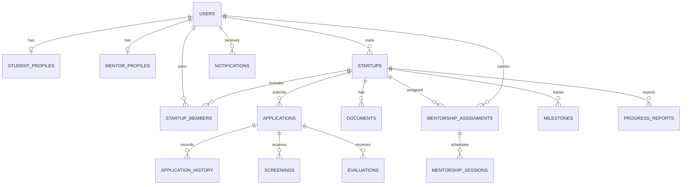

# StartupHub – Database Design (Proposal)

## 1. Database Overview

StartupHub will use **Supabase PostgreSQL** as its relational database. The Node.js and Express.js backend is planned to connect to PostgreSQL using the `pg` package and parameterized SQL queries. Prisma will not be used.

This document is a proposed starting design. Table fields, constraints, and relationships must be finalized against the organization's actual incubation process before migrations are applied.

## 2. Proposed Tables

| Table | Purpose |
|---|---|
| `users` | Login identity, email, password hash, and role |
| `student_profiles` | Student-specific profile information |
| `mentor_profiles` | Mentor profile and expertise |
| `startups` | Startup details and founder/owner reference |
| `startup_members` | Members associated with a startup |
| `applications` | Startup incubation applications and current status |
| `application_history` | Record of application status changes |
| `documents` | Uploaded document metadata and storage path |
| `screenings` | Screening outcomes, notes, and reviewer |
| `evaluations` | Evaluation scores, feedback, and evaluator |
| `mentorship_assignments` | Links mentors to startups |
| `mentorship_sessions` | Scheduled or completed mentorship sessions |
| `milestones` | Startup goals and target dates |
| `progress_reports` | Periodic startup progress updates |
| `notifications` | User notifications |
| `announcements` | Platform-wide or role-specific announcements |
| `audit_logs` | Important administrative and security actions |

## 3. Main Relationships

- A user may have a student profile or mentor profile according to their role.
- A student may own or be associated with one or more startups, depending on the final business rules.
- A startup can have multiple team members.
- A startup can submit applications over time, subject to the organization's rules.
- An application can have multiple history, screening, and evaluation records.
- A startup can have multiple documents, milestones, and progress reports.
- A mentor can be assigned to multiple startups.
- A startup can have mentorship sessions through its mentor assignments.
- A user can receive multiple notifications.

## 4. Relationship Diagram

This is a conceptual relationship diagram, not a final SQL schema. Foreign keys and optional relationships should be confirmed during database design.

## 5. Database Design Guidelines

- Give each table a primary key.
- Use foreign keys to maintain valid relationships.
- Add unique constraints for fields such as user email where appropriate.
- Use timestamps such as `created_at` and `updated_at`.
- Store password hashes, never plain-text passwords.
- Use transactions for operations that must succeed or fail together.
- Use parameterized queries in the backend.
- Add indexes for frequently searched or joined columns.
- Keep a history of important application status changes.
- Define retention and access rules for uploaded documents and personal data.

## 6. Supabase Responsibilities

Supabase will provide the managed PostgreSQL database. SQL schema and migration files will be maintained in the repository under `supabase/migrations/`.

If Supabase Storage is selected for uploaded documents, store file metadata and storage paths in PostgreSQL rather than storing large file contents directly in database rows.

## 7. Pending Decisions

Before implementing the final schema, confirm:

- Whether a student can own multiple startups.
- Whether a startup can submit more than one application.
- Which application statuses and transitions are allowed.
- Whether mentors can be assigned by an administrator only.
- Which documents are required at each stage.
- Which records each role can view or edit.
- Whether soft deletion and audit history are required.
