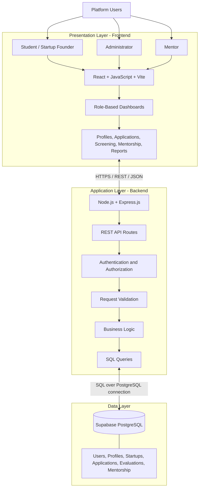

# StartupHub – System Architecture

## 1. Architecture Overview

StartupHub is planned as a three-tier web application:

1. **Presentation layer:** React frontend built with JavaScript and Vite.
2. **Application layer:** Node.js and Express.js backend.
3. **Data layer:** Supabase-hosted PostgreSQL database.

The frontend communicates with the backend through REST APIs. The backend validates requests, applies business rules and permissions, and queries PostgreSQL.

## 2. Architecture Diagram

## 3. Layer Responsibilities

### 3.1 Presentation Layer – Frontend

**Technology:** React, JavaScript, Vite

Responsibilities:

- Display the user interface.
- Provide separate dashboards based on user roles.
- Collect form data and display validation feedback.
- Show application status, evaluations, and progress.
- Send requests to backend REST APIs.
- Display responses and error messages.

### 3.2 Application Layer – Backend

**Technology:** Node.js, Express.js

Responsibilities:

- Define and expose REST API endpoints.
- Authenticate users and authorize role-specific actions.
- Validate incoming request data.
- Apply application and incubation business rules.
- Execute database queries.
- Handle errors and return consistent JSON responses.

### 3.3 Data Layer – Database

**Technology:** Supabase PostgreSQL

Responsibilities:

- Store user accounts and profiles.
- Store startup and team information.
- Maintain applications and application history.
- Store screening and evaluation records.
- Maintain mentor assignments and sessions.
- Store milestones, progress reports, and notification records.

## 4. Request and Response Flow

1. A user performs an action in the React frontend.
2. The frontend sends an HTTP request to an Express API endpoint.
3. Backend middleware authenticates the user and checks permissions.
4. The backend validates the request and runs the required business logic.
5. The backend executes SQL queries against Supabase PostgreSQL.
6. PostgreSQL returns the query result.
7. Express sends an appropriate JSON response.
8. The frontend updates the interface.

## 5. Security Boundaries

- Keep database credentials and JWT secrets in backend environment variables.
- Never expose a database password or Supabase service-role key in frontend code.
- Enforce role and record-level permissions on the backend.
- Validate and sanitize incoming data.
- Use parameterized SQL queries to reduce SQL injection risk.
- Validate uploaded file type and size.
- Use HTTPS in production.

## 6. Implementation Note

This document describes the target architecture. The existing Figma-generated frontend is the starting point. The Express backend and Supabase database integration must be implemented and tested separately.
